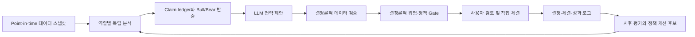

# TradingAgents 의사결정 설계 분석

> 분석 목적: `TauricResearch/TradingAgents`를 실행하거나 복제하는 것이 아니라, 기존 Codex 주식 분석·매매판단 Skill에 적용할 가치가 있는 **의사결정 설계 원칙**만 추출한다.  
> 분석 기준일: 2026-08-11  
> 분석 대상: TradingAgents v0.3.1, Git commit [`a33fd4c0f134485a43553a2c23a63cb14adbd88f`](https://github.com/TauricResearch/TradingAgents/commit/a33fd4c0f134485a43553a2c23a63cb14adbd88f)

## 1. 최종 결론

TradingAgents에서 반드시 가져올 것은 “여러 LLM이 토론하면 정답에 가까워진다”는 발상이 아니다. 반드시 가져올 가치가 있는 것은 다음 다섯 가지다.

1. **역할별 독립 산출물과 명시적 hand-off**
2. **정반대 논리를 의무적으로 검토하는 bounded debate**
3. **LLM 설명과 결정론적 데이터·정책 검증을 분리하는 구조**
4. **결정 당시의 논리와 사후 성과를 연결하는 decision journal / reflection**
5. **모든 LLM 산출물을 비신뢰 연구 제안으로 취급하고, 최종 행동은 deterministic policy gate와 사람에게 남기는 경계**

반대로, TradingAgents의 `Trader`가 진입가·손절가·비중을 만들고 LLM `Portfolio Manager`가 최종 승인하는 구조는 기존 Skill에 그대로 도입하면 안 된다. 코드상 이들은 실제 포트폴리오 현금, 보유수량, 레버리지, 상관관계, 최대 허용손실과 같은 필수 상태를 받지 않으며, 정량 위험한도도 집행하지 않는다. 이름은 Trader·Risk Manager·Portfolio Manager지만 실제 기능은 **LLM 기반 제안자·토론자·요약자**에 가깝다.

최종 분류는 다음과 같다.

- **A — 반드시 도입할 가치가 있음:** 12개 원칙
- **B — 선택적으로 도입:** 9개 원칙
- **C — 기존 Codex Skill에는 불필요하거나 금지:** 9개 원칙

권장 목표 구조는 다음과 같다.



핵심 원칙은 단순하다.

> **LLM은 조사·반론·시나리오·설명을 담당하고, 숫자 검증·위험한도·매매 가능 여부·상태 변경은 결정론적 코드가 담당한다. 실제 체결은 사용자만 한다.**

---

## 2. 분석 범위와 원본 검증

### 2.1 사용한 원본

- 사용자 제공 ZIP: `E:/Users/금동한/Downloads/TradingAgents-main (1).zip`
- ZIP SHA-256: `0D8DCB31DBA9A534EBEEB3913F5D70FB45A8F2644662D1768BF6EB0C2ADE4219`
- 공식 저장소: [TauricResearch/TradingAgents](https://github.com/TauricResearch/TradingAgents)
- 공식 기준 commit: [`a33fd4c`](https://github.com/TauricResearch/TradingAgents/commit/a33fd4c0f134485a43553a2c23a63cb14adbd88f)
- 패키지 버전: `0.3.1`

ZIP에는 `.git` 메타데이터가 없으므로 단순히 파일 날짜로 버전을 추정하지 않았다. 대신 핵심 파일의 Git blob hash를 공식 commit의 blob SHA와 대조했다.

| 파일 | 로컬 ZIP blob hash | 공식 GitHub blob hash | 결과 |
|---|---|---|---|
| `pyproject.toml` | `c3021a5bf0e21b9cfe42f831131f3409250d7415` | 동일 | 일치 |
| `CHANGELOG.md` | `8e926b004edf19008b39e0d2f773c4c65070d74f` | 동일 | 일치 |
| `trading_graph.py` | `a1902177d4f5624ed2e298f62d394eb29da065e6` | 동일 | 일치 |
| `memory.py` | `ff9e94579bfcf256712c6daf0fd4d0fbbb9290c1` | 동일 | 일치 |
| `market_data_validator.py` | `baa5efecf0ed100ec09c06d571482090a1a4db18` | 동일 | 일치 |

따라서 이 문서는 사용자 제공 ZIP과 2026-07-18 기준 공식 `main` commit이 동일한 코드 스냅샷이라는 전제에서 작성했다.

### 2.2 검토한 범위

- LangGraph 조립·분기·checkpoint
- 네 분석 역할과 데이터 도구
- Bull/Bear Researcher와 Research Manager
- Trader
- Aggressive/Conservative/Neutral risk debaters
- Portfolio Manager
- Pydantic structured output와 free-text fallback
- decision log, outcome resolution, reflection
- OHLCV·뉴스·재무·거시 데이터의 날짜 필터
- stale cache, 심볼 식별, no-data 처리
- look-ahead·checkpoint·temperature·structured-output 관련 회귀 테스트

TradingAgents 자체를 실행해 수익률을 평가하지는 않았다. 이 문서의 대상은 성과가 아니라 **의사결정 설계 품질**이다.

---

## 3. 실제 파이프라인 구조

공식 그래프는 다음 순서로 동작한다. Analyst Team은 병렬이 아니라 선택된 순서대로 실행된다.

```text
Initial State
  -> Market / Sentiment / News / Fundamentals Analysts (selected, sequential)
  -> Bull Researcher
  <-> Bear Researcher (fixed round count)
  -> Research Manager
  -> Trader
  -> Aggressive Risk Analyst
  -> Conservative Risk Analyst
  -> Neutral Risk Analyst (fixed round count)
  -> Portfolio Manager
  -> Final rating
  -> Decision log
  -> Later return/alpha lookup and LLM reflection
```

근거는 [`setup.py`](https://github.com/TauricResearch/TradingAgents/blob/a33fd4c0f134485a43553a2c23a63cb14adbd88f/tradingagents/graph/setup.py)와 [`conditional_logic.py`](https://github.com/TauricResearch/TradingAgents/blob/a33fd4c0f134485a43553a2c23a63cb14adbd88f/tradingagents/graph/conditional_logic.py)다.

초기 공통 상태에는 ticker, asset type, 거래일, 도구로 확인한 instrument context, 각 analyst report, 두 debate state, research plan, trader plan, final decision, past decision context가 들어간다. 이 방식은 역할 사이 정보 계약을 눈에 보이게 만든다는 점에서 좋다.

다만 `messages`는 analyst 사이에서 clear node를 거치고, 핵심 정보는 별도 report field로 전달된다. 즉 “에이전트들이 자유롭게 대화하는 집단지성”보다는 **정해진 상태 머신 안에서 자유서술 산출물을 순차 전달하는 파이프라인**이라고 보는 것이 정확하다.

---

## 4. Analyst Team 역할과 입력·출력

### 4.1 공통 설계

| 역할 | 주요 입력 | 처리 방식 | 주요 출력 | Codex 관점 |
|---|---|---|---|---|
| Market / Technical | ticker, trade date, instrument context, OHLCV·indicator tools | 도구 호출 후 LLM 해석 | `market_report` | 검증 snapshot은 A, 자유해석은 B |
| Fundamental | ticker, trade date, 재무 도구 | 기업개요·재무제표를 LLM이 종합 | `fundamentals_report` | 역할 분리는 A, point-in-time 보완 필수 |
| News | ticker, trade date, 기업·글로벌 뉴스, FRED, insider, prediction market | LLM이 촉매와 거시 맥락 종합 | `news_report` | 역할 분리는 A, source ledger 필요 |
| Sentiment | Yahoo news, live StockTwits, live Reddit | 사전수집 데이터로 structured sentiment 생성 | `sentiment_report` | 실시간 보조신호는 B, 역사 백테스트에는 C |

모든 analyst가 별도 산출물을 만든다는 원칙은 도입 가치가 높다. 다만 현재 세 역할의 최종 report는 자유서술이고, claim ID·source URL·publication time·as-of time·confidence가 필수 필드가 아니다. 따라서 downstream agent가 보고서를 인용해도 원자료까지 추적하기 어렵다.

기존 Skill에 도입할 때 analyst 출력은 최소한 다음 공통 schema를 가져야 한다.

```yaml
role:
as_of:
cutoff:
claims:
  - claim_id:
    statement:
    source_id:
    source_tier:
    observed_at:
    published_at:
    value:
    unit:
    confidence:
    contradiction_status:
unknowns: []
scenario_implications: []
```

### 4.2 Fundamental Analyst

현재 구현은 `get_fundamentals`, `get_balance_sheet`, `get_cashflow`, `get_income_statement`를 호출하고 상세한 회사 보고서를 만든다. 역할 자체는 필요하지만 현재 데이터 시점 통제는 완전하지 않다.

강점:

- 정성·정량 기업 분석을 기술·뉴스와 분리한다.
- 재무제표 도구가 별도라서 데이터 수집 경로가 보인다.
- 자료가 없을 때 no-data 신호를 반환하는 경로가 있다.

한계:

- yfinance `get_fundamentals`의 현재 `info` snapshot은 `curr_date`를 사용하지 않는다.
- yfinance 재무제표는 fiscal period end가 분석일 이전인지 확인할 뿐, 실제 filing/publication date를 확인하지 않는다.
- Alpha Vantage도 `fiscalDateEnding <= curr_date`로 필터링하며, 당시 시장 참여자가 그 보고서를 실제로 볼 수 있었는지는 검증하지 않는다.
- restatement와 vendor의 현재 재작성 데이터를 point-in-time vintage로 고정하지 않는다.
- “past week fundamentals”라는 prompt는 재무제표의 보고주기와 맞지 않는다.

판정: **역할 분리는 A, 현 데이터 구현은 B이며 역사 백테스트의 point-in-time 원천으로는 불충분하다.**

### 4.3 Technical / Market Analyst

이 역할은 `get_stock_data`, `get_indicators`, `get_verified_market_snapshot`을 사용한다. LLM은 최대 8개 지표를 선택하고, 최종 보고서 작성 전 deterministic snapshot을 호출하도록 명시돼 있다.

가장 좋은 부분은 [`market_data_validator.py`](https://github.com/TauricResearch/TradingAgents/blob/a33fd4c0f134485a43553a2c23a63cb14adbd88f/tradingagents/dataflows/market_data_validator.py)다. 이 모듈은 분석일 이후 OHLCV를 다시 제거하고, 고정 indicator set을 직접 계산해 정확한 가격·지표 주장의 source of truth를 만든다. 서로 다른 도구가 충돌하면 숫자를 임의 조정하지 말고 불일치로 표시하도록 한다.

강점:

- 정확한 OHLCV와 지표 수치는 LLM이 아니라 코드가 계산한다.
- 분석일 이후 row를 방어적으로 재차 제거한다.
- stale OHLCV를 거부하고 빈 데이터를 명확한 실패로 처리한다.
- 동일한 indicator snapshot 형태를 반복 생성한다.

한계:

- LLM이 어떤 지표를 고르고 어떻게 해석할지는 비결정적이다.
- 기본 verified set에는 EMA10, SMA50/200, RSI, Bollinger, MACD, ATR이 있으나 EMA20, SMA20/60, RVOL, Stoch(20,3,3), Chaikin(3,10) 등 사용자의 정책 지표 전체는 없다.
- 당일 일봉은 장중 partial candle일 수 있다. 15분 cache TTL은 freshness를 높일 뿐 “미국 정규장 완료”를 보장하지 않는다.
- support/resistance, gap, halt, split, leveraged ETF daily-reset 위험을 정량 정책으로 검증하지 않는다.

판정: **verified snapshot과 불일치 fail-closed 원칙은 A. LLM의 지표 선택과 기술 해석은 B. LLM report를 직접 매매 trigger로 쓰는 것은 C.**

### 4.4 News Analyst

기업 뉴스, 글로벌 뉴스, insider transactions, FRED macro, prediction markets를 함께 본다. 비정형 정보를 종합하는 LLM의 강점과 잘 맞는 역할이다.

강점:

- 기업 촉매와 거시 환경을 별도 역할에서 다룬다.
- FRED와 prediction market을 명시적 도구로 분리한다.
- Yahoo 뉴스는 publication timestamp를 이용해 역사 window 이후 기사를 제외한다.
- 역사 실행에서 날짜가 없는 Yahoo 기사는 제외한다.

한계:

- 기사별 evidence ID·원문 URL·publish time을 downstream schema가 강제하지 않는다.
- source quality, 중복기사, 원문/재전재 구분, event date와 publication date 구분이 정책화돼 있지 않다.
- insider transaction tool에는 `curr_date` 인자가 없어 역사 실행에서 미래 거래를 볼 가능성이 있다.
- prediction market은 현재 snapshot이며 역사 시점 snapshot 저장이 없다.
- FRED는 `observation_end`를 제한하지만 ALFRED vintage가 아니므로 수정된 거시 데이터가 과거 분석에 들어갈 수 있다.

판정: **News 역할은 A. prediction market·광범위 macro 도구는 B. 출처 없는 LLM 요약을 매매 근거로 쓰는 것은 C.**

### 4.5 Sentiment Analyst

현재 버전은 과거처럼 존재하지 않는 Reddit/X/StockTwits 내용을 LLM이 꾸며내지 않도록 Yahoo news, StockTwits, Reddit 데이터를 먼저 prompt에 넣고, sentiment band·score·confidence를 structured output으로 만든다. 이 개선 방향은 좋다.

그러나 중요한 결함이 있다. [`sentiment_analyst.py`](https://github.com/TauricResearch/TradingAgents/blob/a33fd4c0f134485a43553a2c23a63cb14adbd88f/tradingagents/agents/analysts/sentiment_analyst.py)는 Yahoo 뉴스에는 `trade_date` window를 주지만 StockTwits와 Reddit fetcher에는 역사 cutoff를 전달하지 않는다. 즉 과거 날짜를 분석해도 **현재의 최근 소셜 데이터**가 들어간다.

따라서:

- 실시간·현재 시점 보조 맥락: **B**
- 과거 백테스트 입력: **C**
- sentiment를 독립적인 매수·매도 trigger로 사용: **C**

기존 Skill에서 사용하려면 `as_of <= cutoff`, 원문 timestamp, 표본수, bot/중복 제거, source coverage를 검증하고 낮은 권한의 보조 신호로만 써야 한다.

---

## 5. Bull / Bear Researcher 토론 구조

### 5.1 실제 구조

Bull과 Bear는 네 analyst report와 전체 debate history를 받는다. Bull은 성장·경쟁우위·긍정지표·반론을 만들고, Bear는 위험·경쟁약점·부정지표·반론을 만든다. 기본 설정에서는 Bull과 Bear가 한 번씩 말하고, 설정한 round 수에 따라 고정 횟수로 교대한다.

Research Manager는 원 analyst report를 다시 검토하지 않고 debate history를 읽어 5단계 recommendation, rationale, strategic actions를 만든다. 이 구조는 생각의 누락을 줄이지만, debate가 원자료를 잘못 인용하면 Manager가 그 오류를 그대로 압축할 수 있다.

### 5.2 도입할 부분

**A — 독립된 bull/bear steelman**

- 최초 bull memo와 bear memo는 서로의 답을 보기 전에 독립 작성한다.
- 각 주장은 반드시 `claim_id`와 source evidence를 인용한다.
- Bear는 가격하락 가능성뿐 아니라 “투자 논리가 틀렸음을 확인할 조건”을 제시한다.
- Bull은 위험을 무시하지 않고 bear의 strongest claim을 정확히 재진술한 뒤 반박한다.

**B — 제한된 cross-examination**

- 1~2회 교차검토는 누락 탐지에 유용하다.
- 비용 제한과 시간 제한을 둔다.
- 단순 횟수 대신 `새 evidence`, `미해결 핵심 쟁점`, `반복률`로 종료할 수 있다.

### 5.3 도입하면 안 되는 부분

**C — 자유서술 debate history를 사실 원장으로 사용**

- 현재 코드는 claim provenance를 강제하지 않는다.
- 동일한 quick LLM이 양측을 맡아 오류가 상관될 수 있다.
- 고정 round는 새로운 정보가 없어도 토론을 계속하고, 중요한 쟁점이 남아도 끝난다.
- 설득력 있는 문장이 정확한 데이터보다 우세해질 수 있다.

권장 방식은 debate transcript가 아니라 **쟁점표**다.

| Issue ID | Bull claim | Bear claim | Evidence IDs | 검증 상태 | 미해결 조건 |
|---|---|---|---|---|---|
| I-001 | 수요 성장 지속 | 고객 CAPEX 둔화 | E-01, E-09 | conflict | 다음 가이던스 |

---

## 6. Trader의 의사결정 방식

Trader는 Research Manager의 `investment_plan`을 받아 `Buy/Hold/Sell`, reasoning, optional entry price, stop loss, position sizing을 만든다. Pydantic schema 덕분에 출력 형식은 비교적 안정적이다.

그러나 코드상 Trader prompt에는 “analysts' reports”에 기반하라고 쓰여 있어도 실제 user message에 들어가는 것은 instrument context와 **Research Manager의 plan뿐**이다. 원 analyst reports, claim ledger, 현재 보유수량, 현금, 평균단가, 사용자 최대 허용손실, 포트폴리오 총 레버리지, 상관관계는 없다.

따라서 다음을 구분해야 한다.

- 전략 후보와 설명을 만드는 **LLM Trade Proposer**: **B**
- 진입가·손절가·비중의 최종 계산자: **C**
- 매매 승인자 또는 주문 생성자: **C**

기존 Skill에서 LLM Trader를 쓰더라도 출력은 다음 정도로 제한해야 한다.

```yaml
proposal_only: true
directional_hypothesis:
preferred_setup:
required_confirmations: []
invalidation_conditions: []
unresolved_risks: []
evidence_ids: []
```

가격·수량·손절·분할비중은 verified snapshot과 portfolio state를 읽는 deterministic calculator가 계산해야 한다. proposal과 validated action은 별도 artifact여야 한다.

---

## 7. Risk Management의 역할

### 7.1 실제 구현

Risk 단계는 Aggressive, Conservative, Neutral 세 LLM persona가 Trader proposal과 analyst reports를 놓고 교대 토론한다.

- Aggressive: upside와 위험수용을 옹호
- Conservative: 손실·변동성·지속가능성을 강조
- Neutral: 양쪽을 절충

이것은 시나리오 탐색에는 유용하지만 실제 risk management는 아니다. 다음이 없다.

- 포트폴리오 현금과 보유수량
- gross/net exposure와 effective leverage
- 종목·섹터·factor concentration
- correlation과 common-underlying 중복
- position-level max loss와 portfolio drawdown budget
- liquidity, spread, gap, halt, borrow, option assignment 위험
- leveraged ETF daily reset와 volatility decay
- hard veto, cooldown, re-arm, emergency override

### 7.2 Codex Skill에 적용할 원칙

**A — 독립 Risk Gate와 veto 권한**

Risk Gate는 persona 토론이 아니라 코드여야 한다. 예:

```text
IF evidence_status != PASS                     -> BLOCK
IF portfolio_state is stale                    -> BLOCK
IF proposed_notional > available_cash          -> BLOCK
IF effective_leverage > dynamic_leverage_cap   -> BLOCK
IF position_loss_budget breached               -> REDUCE / BLOCK ADD
IF signal slot is not re-armed                  -> BLOCK DUPLICATE REDUCTION
IF gap_or_halt_state unresolved                 -> HUMAN REVIEW
```

**B — 세 risk 관점의 시나리오 분석**

Aggressive/Neutral/Conservative 시나리오는 확률·조건·손실 범위를 검토하는 연구 단계로는 유용하다. 단, 매매 가능 여부를 바꿀 권한은 없어야 한다.

**C — risk persona 합의를 위험관리로 간주**

문장 토론은 손실한도를 집행하지 못한다. 세 LLM이 모두 찬성해도 policy breach는 차단되어야 한다.

---

## 8. Portfolio Manager의 최종 승인 구조

현재 Portfolio Manager는 Research Manager plan, Trader proposal, risk debate history, 과거 lessons를 받아 5단계 rating, summary, thesis, optional price target과 horizon을 만든다. typed schema와 한 번의 구조화 호출은 formatting 관점에서 좋다.

하지만 이것은 진정한 최종 승인 구조가 아니다.

- LLM이 만든 최종 rating을 deterministic parser가 읽을 뿐, rating의 근거는 여전히 비결정적이다.
- policy breach를 veto하는 코드가 없다.
- 포트폴리오 상태와 사용자 제약이 입력되지 않는다.
- source claim을 원자료와 재검증하지 않는다.
- structured output 실패 시 free-text로 계속 진행한다.

기존 Skill에서는 다음 구조가 맞다.

```text
LLM Portfolio Synthesizer
  -> Evidence Validator
  -> Technical Signal Validator
  -> Portfolio/Risk Policy Gate
  -> Action Candidate (review only)
  -> Human approval and manual execution
```

분류:

- 최종 설명·시나리오 요약: **B**
- deterministic policy gate: **A**
- LLM의 최종 승인·거부: **C**
- 자동 주문·simulated exchange 연결: **C**

---

## 9. Decision Memory / Reflection 구조

### 9.1 실제 구현

[`memory.py`](https://github.com/TauricResearch/TradingAgents/blob/a33fd4c0f134485a43553a2c23a63cb14adbd88f/tradingagents/agents/utils/memory.py)는 append-oriented markdown decision log를 사용한다.

1. 분석 종료 시 ticker·trade date·rating·final decision을 `pending`으로 기록한다.
2. 같은 ticker를 다음에 분석할 때 pending entry의 향후 가격을 조회한다.
3. raw return과 benchmark alpha를 계산한다.
4. LLM이 2~4문장 reflection을 만든다.
5. 최근 같은 ticker의 full decision과 일부 cross-ticker lesson을 다음 Portfolio Manager prompt에 넣는다.

좋은 점:

- decision과 outcome을 분리해 미래 정보가 초기 결정에 섞이지 않는다.
- pending/resolved 상태와 idempotency guard가 있다.
- temp file replacement로 reflection update를 원자적으로 쓴다.
- raw return뿐 아니라 benchmark alpha를 기록한다.
- 과거 lesson이 없을 때 가짜 기억을 만들지 않는다.

한계:

- outcome은 실제 체결이 아니라 `trade_date`부터의 시세 수익률이다.
- 첫 기준 가격이 trade-date close라면 분석 이후 실제로 체결 가능한 next-session 가격과 다를 수 있다.
- Buy/Overweight/Hold/Underweight/Sell 각각의 방향성과 sizing을 동일한 return 평가로 단순화한다.
- 기본 평가 horizon은 5 trading rows로 짧고 단일 horizon이다.
- reflection 자체가 LLM 문장이며 정답 라벨이 아니다.
- cross-ticker lesson은 regime·asset type·strategy type이 달라도 주입된다.
- 데이터·prompt·model·policy version hash와 evidence snapshot을 저장하지 않는다.
- 실제 사용자 체결과 recommendation을 분리하는 field가 없다.

### 9.2 권장 적용

**A — decision journal과 deferred evaluation**은 반드시 도입할 가치가 있다. 다만 다음 schema가 더 적합하다.

```yaml
decision_id:
run_id:
as_of:
ticker:
strategy_id:
policy_version:
model_manifest:
evidence_snapshot_hash:
portfolio_state_hash:
proposal:
validated_action:
human_decision:
confirmed_fill: null
thesis:
falsification_criteria: []
evaluation_horizons: [1d, 5d, 20d, thesis_horizon]
outcomes:
policy_breaches:
reflection_candidate:
policy_change_status: research_only
```

중요한 원칙:

- recommendation, user decision, confirmed fill을 절대 합치지 않는다.
- 가격 움직임으로 fill을 추정하지 않는다.
- reflection은 향후 조사 context일 뿐 policy를 자동 변경하지 못한다.
- 정책 변경은 충분한 표본, walk-forward, regime 분할, 비용·슬리피지 반영 후 별도 승인한다.
- 같은 ticker뿐 아니라 동일 strategy/regime/leveraged-product 기준으로 memory를 검색한다.

---

## 10. 데이터 검증과 look-ahead 방지

### 10.1 잘한 부분

v0.3.1은 이전 버전의 여러 look-ahead와 stale-data 문제를 실제로 수정했다. 공식 [`CHANGELOG.md`](https://github.com/TauricResearch/TradingAgents/blob/a33fd4c0f134485a43553a2c23a63cb14adbd88f/CHANGELOG.md)와 테스트에서 확인되는 장점은 다음과 같다.

- OHLCV row를 `curr_date` 이하로 제한
- verified snapshot에서 동일 cutoff를 방어적으로 재적용
- yfinance inclusive end-date 보정
- 지나치게 오래된 OHLCV frame 거부
- same-day cache TTL로 장중 stale candle 재사용 완화
- Yahoo 뉴스의 flat/nested timestamp 처리
- 역사 window에서 미래·undated 기사 제외
- Alpha Vantage 재무 report의 미래 fiscal period 제거
- FRED `observation_end=curr_date`
- no-data와 stale-data를 명시적 실패로 전달
- symbol normalization과 deterministic instrument identity

### 10.2 남아 있는 look-ahead / point-in-time 위험

| 데이터 | 현재 통제 | 남은 위험 | Codex 적용 등급 |
|---|---|---|---|
| OHLCV | `Date <= curr_date`, stale guard | 당일 partial candle, split/vendor 재작성, completed-session 미확인 | A 원칙, 보완 필수 |
| Technical indicators | cutoff된 OHLCV로 계산 | 계산 library/version 및 adjusted-price 정책 미기록 | A 원칙, provenance 추가 |
| Yahoo news | timestamp window, undated historic exclusion | event time·최초 공개시각·수정기사 문제 | A 원칙, source ledger 추가 |
| StockTwits/Reddit | live recent fetch | 과거 trade_date 분석에 현재 소셜 데이터 유입 | 역사 분석에는 C |
| yfinance company overview | 현재 `info` | `curr_date` 미사용, 과거 실행에 현재 snapshot 유입 | 역사 분석에는 C |
| 재무제표 | fiscal period end cutoff | filing/publication lag, restatement, vendor vintage | 불충분; point-in-time source 필요 |
| Insider transactions | 최신 목록 | `curr_date` 필터 없음 | 역사 분석에는 C |
| FRED | observation date cutoff | 현재 revised vintage 사용 가능 | ALFRED/release-calendar 필요 |
| Prediction market | live market snapshot | 역사 snapshot 없음 | 역사 분석에는 C |
| Outcome/Reflection | 미래 가격을 나중에 조회 | trade-date close 기준, 실제 fill과 불일치 | 평가 설계 보완 필요 |

따라서 “look-ahead filter가 있다”와 “point-in-time backtest가 안전하다”는 같은 말이 아니다. TradingAgents는 OHLCV와 Yahoo news에서는 방어가 상당히 개선됐지만, 전체 파이프라인은 아직 point-in-time safe backtester가 아니다.

기존 Skill의 필수 검증 gate는 다음 순서가 적절하다.

1. instrument identity 검증
2. 시장·session 상태와 latest completed bar 확인
3. source별 `published_at <= cutoff` 확인
4. 재무자료의 filing/availability date 확인
5. vendor 2개 이상 교차검증 또는 공식 원문 우선
6. 숫자·단위·통화·split adjustment 일치 확인
7. 불일치가 있으면 임의 reconciliation 금지
8. 검증 실패 시 action을 `RESEARCH_ONLY` 또는 `BLOCKED`로 낮춤

---

## 11. 재현성과 비결정성

공식 README도 LLM sampling이 비결정적이며 temperature를 낮춰도 byte-identical output을 보장하지 않는다고 명시한다. reasoning model은 temperature를 무시하거나 변동이 더 클 수 있고, 공식 문서도 이 프레임워크를 고정 수익률 전략이 아니라 research scaffold로 보라고 한다. 자세한 내용은 [README의 Reproducibility 절](https://github.com/TauricResearch/TradingAgents/blob/a33fd4c0f134485a43553a2c23a63cb14adbd88f/README.md#reproducibility)에서 확인할 수 있다.

### 11.1 재현성에 도움이 되는 요소

- 그래프 순서와 debate/risk speaker routing은 결정론적이다.
- debate round 수와 analyst selection이 config로 고정된다.
- Research Manager, Trader, Portfolio Manager, Sentiment는 typed schema를 사용한다.
- checkpoint thread ID가 ticker, date, analyst set, debate depth, risk depth, asset type을 포함한다.
- full state log와 decision log를 남긴다.
- temperature와 provider 설정을 외부 config로 명시할 수 있다.

### 11.2 재현성을 깨는 요소

- 동일 model·temperature에서도 LLM 내용은 달라진다.
- reasoning model은 temperature로 충분히 통제되지 않는다.
- structured call 실패 시 free-text로 fallback하여 output contract가 약해진다.
- model alias, provider implementation, prompt template가 시간에 따라 변할 수 있다.
- Yahoo·StockTwits·Reddit·FRED·prediction market 응답이 mutable하다.
- analyst의 tool 선택과 indicator 선택이 비결정적이다.
- 과거 reflection이 다음 run에 들어가 path dependence를 만든다.
- debate는 같은 모델의 상관된 오류를 증폭할 수 있다.
- source payload와 prompt의 cryptographic hash가 decision log에 없다.
- 외부 텍스트가 prompt에 직접 삽입돼 prompt injection 또는 instruction contamination 가능성이 있다.

### 11.3 Codex Skill의 권장 재현성 기준

완전한 LLM 재현성을 목표로 해서는 안 된다. 대신 **행동 재현성**을 보장해야 한다.

- 동일 verified data snapshot + 동일 portfolio state + 동일 policy version이면 deterministic gate 결과가 동일해야 한다.
- LLM이 다른 결론을 내도 policy-allowed action set은 동일해야 한다.
- 모든 run에 model ID, provider, temperature/reasoning setting, prompt version, source hashes, code version, policy version을 기록한다.
- structured output 실패 시 decision layer는 free-text fallback하지 않고 fail closed한다.
- N회 반복 실행은 “다수결 정답”을 만들기 위한 것이 아니라 instability를 측정하기 위해 사용한다.
- 동일 evidence에서 recommendation 분산이 크면 confidence를 낮추고 human review로 보낸다.

---

## 12. A/B/C 분류

### A. 반드시 도입할 가치가 있음

| # | 설계 원칙 | 도입 이유 | 적용 형태 |
|---:|---|---|---|
| A1 | 역할별 독립 분석 artifact | 혼합 추론과 누락을 줄임 | Fundamental/Technical/News/Sentiment 별 schema |
| A2 | 명시적 input/output contract | downstream 왜곡과 parser drift를 줄임 | typed JSON/YAML, required fields |
| A3 | deterministic verified market snapshot | LLM 숫자 환각을 차단 | OHLCV·EMA·MA·MACD 등 코드 계산 |
| A4 | data conflict fail-closed | 충돌 숫자의 임의 조정을 방지 | `PASS/WARN/FAIL/BLOCKED` 상태 |
| A5 | point-in-time cutoff gate | look-ahead를 구조적으로 차단 | completed session·publish/filing time 검증 |
| A6 | 독립 Bull/Bear steelman | confirmation bias를 줄임 | blind memo 후 claim-based rebuttal |
| A7 | falsification criteria | 사후 합리화를 줄임 | 투자 전 무효화 조건 필수 기록 |
| A8 | deterministic risk veto | LLM 찐빠가 매매로 이어지는 것을 방지 | 현금·레버리지·손실·re-arm hard gate |
| A9 | 인간 최종 승인과 수동 체결 | 권한 경계를 보장 | action은 review candidate only |
| A10 | append-only decision journal | 조사→결정→평가를 연결 | recommendation/user decision/fill 분리 |
| A11 | deferred multi-horizon evaluation | 결과를 본 뒤 과거 논리를 바꾸지 않음 | 1d/5d/20d/thesis horizon, alpha 포함 |
| A12 | provenance/repro manifest | 실행 결과를 재검증 가능하게 함 | source·prompt·model·policy·snapshot hash |

### B. 선택적으로 도입

| # | 기능 | 유용한 경우 | 제한 조건 |
|---:|---|---|---|
| B1 | analyst 선택 실행 | 비용·시간을 줄여야 할 때 | 필수 risk/data gate는 생략 불가 |
| B2 | quick/deep model 분리 | 요약과 판단 비용 최적화 | model tier가 권한 차이를 의미하지 않음 |
| B3 | 1~2회 cross-examination | 핵심 쟁점의 누락 탐지 | claim ledger와 반복 종료 조건 필요 |
| B4 | Sentiment 역할 | 현재 시점의 보조 맥락 | 낮은 가중치, 역사 실행 금지 또는 snapshot 필요 |
| B5 | FRED·prediction market 맥락 | macro/event 시나리오 | vintage와 timestamp 검증 필요 |
| B6 | LLM Trader proposal | setup 후보와 무효화 조건 생성 | 가격·비중·승인 권한 금지 |
| B7 | LLM Portfolio narrative | 사용자용 결론 설명 | deterministic gate 이후에만 표시 |
| B8 | cross-ticker lessons | 같은 strategy/regime의 반복 오류 탐지 | 무관 ticker 교훈의 무차별 주입 금지 |
| B9 | checkpoint/resume | 장시간 조사 복구 | input·graph·policy·source signature 포함 |

### C. 기존 Codex Skill에는 불필요하거나 금지

| # | 기능 | 제외 이유 |
|---:|---|---|
| C1 | TradingAgents 전체 LangGraph를 그대로 복제 | 현재 Skill에는 과도한 orchestration·비용·상태 복잡성 |
| C2 | LLM Trader가 entry/stop/size 최종 결정 | 포트폴리오 상태와 hard risk 제약을 집행하지 못함 |
| C3 | LLM Portfolio Manager의 최종 승인 | structured prose는 deterministic approval이 아님 |
| C4 | Risk persona 토론을 실제 risk engine으로 사용 | 수치 한도·veto·portfolio exposure가 없음 |
| C5 | free-text fallback을 decision layer에서 허용 | schema 실패를 감춘 채 권한 있는 결과가 생성됨 |
| C6 | raw debate transcript를 source of truth로 사용 | provenance가 없고 오류가 누적·압축됨 |
| C7 | live StockTwits/Reddit를 역사 분석에 사용 | 미래 데이터가 과거 trade date에 유입됨 |
| C8 | analyst prompt의 `FINAL TRANSACTION PROPOSAL` stop 문구 | analyst 역할을 거래 판단과 혼동하고 외부 텍스트 오염에 취약 |
| C9 | 자동 주문·simulated exchange 실행 경로 | 사용자 정책상 주문은 직접 실행하며 Codex는 주문하지 않음 |

---

## 13. 기존 Codex Skill에 적용할 권장 설계

아직 Skill을 수정하지 않는다는 조건에서, 향후 적용안만 제시한다.

### Phase 1 — Evidence Pack

- analysis cutoff와 latest completed U.S. regular session 확정
- ticker·leveraged ETF·underlying identity 확인
- 공식·1차 출처 우선 수집
- OHLCV와 기술지표 deterministic 계산
- source별 timestamp·통화·단위·adjustment 기록
- 데이터 충돌·누락·staleness 판정

출력: `evidence_pack.json`

### Phase 2 — Role-separated Research

- Fundamental
- Technical
- News/Macro
- Sentiment, 필요 시에만

각 역할은 claim ID를 인용하고 action을 직접 결정하지 않는다.

출력: `research_bundle.json`

### Phase 3 — Adversarial Review

- 독립 Bull memo
- 독립 Bear memo
- thesis falsification table
- unresolved conflict table

출력: `debate_ledger.json`

### Phase 4 — Strategy Proposal

LLM은 상승·기본·하락 시나리오, 필요한 확인 신호, 무효화 조건을 제안한다. 아직 수량과 주문은 만들지 않는다.

출력: `strategy_proposal.json`

### Phase 5 — Deterministic Validation

- data quality gate
- technical trigger state
- policy slot / re-arm state
- position loss·peak drawdown·time stop
- cash·gross exposure·effective leverage·correlation
- gap·halt·corporate action 상태
- no-fill/no-order boundary

출력: `validated_action_candidate.json`

### Phase 6 — Human Decision

사용자가 직접 `accept / modify / reject`하고 실제 체결 정보를 명시적으로 제공한다. 시스템은 시세가 주문가를 통과했다는 이유로 체결을 추정하지 않는다.

### Phase 7 — Post-evaluation

- recommendation outcome
- confirmed execution outcome
- benchmark alpha
- MAE/MFE와 drawdown
- thesis condition pass/fail
- rule-level false positive/false negative
- policy change candidate

정책은 reflection 한 건으로 바꾸지 않는다. 충분한 표본의 walk-forward 검증과 사용자 승인을 거친다.

---

## 14. 도입 전 검증 기준

향후 실제 Skill 변경 전 최소한 다음 eval을 통과해야 한다.

1. **Look-ahead canary**: 미래 가격·뉴스·재무·소셜 데이터를 심어도 cutoff 이후 자료가 차단되는지 확인
2. **Completed-session test**: 장중 partial daily candle이 post-market 종가로 오인되지 않는지 확인
3. **Evidence trace test**: 모든 핵심 숫자가 source ID와 원자료 row로 역추적되는지 확인
4. **Conflict test**: 서로 다른 공급자의 가격·지표가 충돌할 때 action이 fail closed되는지 확인
5. **Schema test**: structured output 실패 시 매매 단계가 free-text로 진행되지 않는지 확인
6. **Policy determinism test**: 동일 snapshot·portfolio·policy에서 같은 allowed action이 나오는지 확인
7. **Prompt-injection test**: 기사·커뮤니티 글의 명령문이 system policy를 바꾸지 못하는지 확인
8. **No-fill inference test**: 가격 움직임만으로 holdings/cash가 바뀌지 않는지 확인
9. **Risk veto test**: LLM 전원이 매수를 주장해도 현금·레버리지·손실한도 위반 시 차단되는지 확인
10. **Reflection isolation test**: LLM reflection이 정책파일을 직접 수정하지 못하는지 확인
11. **Repro manifest test**: 동일 run을 source snapshot과 version 정보로 재검토할 수 있는지 확인
12. **Walk-forward test**: 정책 변경 후보가 다중 regime·비용·슬리피지·leveraged ETF decay를 포함한 OOS 구간에서도 유지되는지 확인

---

## 15. 최종 판단

TradingAgents는 주식 분석용 multi-agent 연구 scaffold로서 역할 분리, 반대논리, 구조화 출력, checkpoint, decision memory, 일부 point-in-time 방어를 잘 보여준다. 특히 verified market snapshot과 delayed reflection은 기존 Skill 개선에 직접적인 가치가 있다.

그러나 다음 오해는 피해야 한다.

> **에이전트 수가 늘어났다고 결정이 결정론적이 되지 않으며, Risk Analyst와 Portfolio Manager라는 이름이 붙었다고 실제 위험통제가 생기지 않는다.**

기존 Codex Skill에는 TradingAgents의 **조직도**가 아니라 다음 통제 원칙을 옮기는 것이 맞다.

- 역할을 분리한다.
- 근거를 구조화한다.
- 반대논리를 의무화한다.
- 숫자는 코드로 검증한다.
- 정책은 코드로 집행한다.
- LLM은 제안만 한다.
- 사용자가 최종 판단하고 직접 체결한다.
- 결과를 기록하되 한 번의 결과로 정책을 바꾸지 않는다.

이 문서 단계에서는 기존 Skill 및 실행 코드를 수정하지 않았다.

---

## 16. 주요 원문 링크

- [Repository README](https://github.com/TauricResearch/TradingAgents/blob/a33fd4c0f134485a43553a2c23a63cb14adbd88f/README.md)
- [Changelog v0.3.1](https://github.com/TauricResearch/TradingAgents/blob/a33fd4c0f134485a43553a2c23a63cb14adbd88f/CHANGELOG.md)
- [Graph setup](https://github.com/TauricResearch/TradingAgents/blob/a33fd4c0f134485a43553a2c23a63cb14adbd88f/tradingagents/graph/setup.py)
- [Conditional routing](https://github.com/TauricResearch/TradingAgents/blob/a33fd4c0f134485a43553a2c23a63cb14adbd88f/tradingagents/graph/conditional_logic.py)
- [Agent state](https://github.com/TauricResearch/TradingAgents/blob/a33fd4c0f134485a43553a2c23a63cb14adbd88f/tradingagents/agents/utils/agent_states.py)
- [Structured schemas](https://github.com/TauricResearch/TradingAgents/blob/a33fd4c0f134485a43553a2c23a63cb14adbd88f/tradingagents/agents/schemas.py)
- [Structured-output fallback](https://github.com/TauricResearch/TradingAgents/blob/a33fd4c0f134485a43553a2c23a63cb14adbd88f/tradingagents/agents/utils/structured.py)
- [Market Analyst](https://github.com/TauricResearch/TradingAgents/blob/a33fd4c0f134485a43553a2c23a63cb14adbd88f/tradingagents/agents/analysts/market_analyst.py)
- [Fundamentals Analyst](https://github.com/TauricResearch/TradingAgents/blob/a33fd4c0f134485a43553a2c23a63cb14adbd88f/tradingagents/agents/analysts/fundamentals_analyst.py)
- [News Analyst](https://github.com/TauricResearch/TradingAgents/blob/a33fd4c0f134485a43553a2c23a63cb14adbd88f/tradingagents/agents/analysts/news_analyst.py)
- [Sentiment Analyst](https://github.com/TauricResearch/TradingAgents/blob/a33fd4c0f134485a43553a2c23a63cb14adbd88f/tradingagents/agents/analysts/sentiment_analyst.py)
- [Bull Researcher](https://github.com/TauricResearch/TradingAgents/blob/a33fd4c0f134485a43553a2c23a63cb14adbd88f/tradingagents/agents/researchers/bull_researcher.py)
- [Bear Researcher](https://github.com/TauricResearch/TradingAgents/blob/a33fd4c0f134485a43553a2c23a63cb14adbd88f/tradingagents/agents/researchers/bear_researcher.py)
- [Research Manager](https://github.com/TauricResearch/TradingAgents/blob/a33fd4c0f134485a43553a2c23a63cb14adbd88f/tradingagents/agents/managers/research_manager.py)
- [Trader](https://github.com/TauricResearch/TradingAgents/blob/a33fd4c0f134485a43553a2c23a63cb14adbd88f/tradingagents/agents/trader/trader.py)
- [Portfolio Manager](https://github.com/TauricResearch/TradingAgents/blob/a33fd4c0f134485a43553a2c23a63cb14adbd88f/tradingagents/agents/managers/portfolio_manager.py)
- [Decision memory](https://github.com/TauricResearch/TradingAgents/blob/a33fd4c0f134485a43553a2c23a63cb14adbd88f/tradingagents/agents/utils/memory.py)
- [Reflection](https://github.com/TauricResearch/TradingAgents/blob/a33fd4c0f134485a43553a2c23a63cb14adbd88f/tradingagents/graph/reflection.py)
- [Verified market snapshot](https://github.com/TauricResearch/TradingAgents/blob/a33fd4c0f134485a43553a2c23a63cb14adbd88f/tradingagents/dataflows/market_data_validator.py)
- [OHLCV cutoff and cache guard](https://github.com/TauricResearch/TradingAgents/blob/a33fd4c0f134485a43553a2c23a63cb14adbd88f/tradingagents/dataflows/stockstats_utils.py)
- [Yahoo news look-ahead filter](https://github.com/TauricResearch/TradingAgents/blob/a33fd4c0f134485a43553a2c23a63cb14adbd88f/tradingagents/dataflows/yfinance_news.py)
- [Trading graph and outcome resolution](https://github.com/TauricResearch/TradingAgents/blob/a33fd4c0f134485a43553a2c23a63cb14adbd88f/tradingagents/graph/trading_graph.py)
